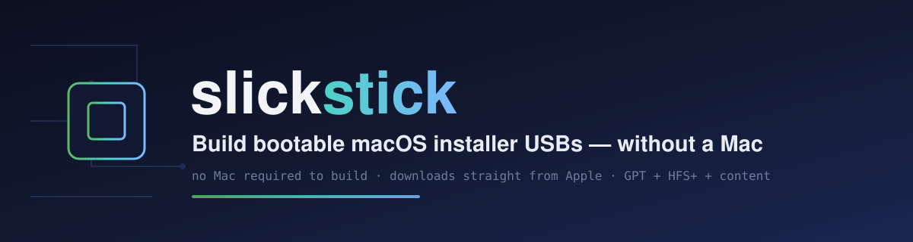
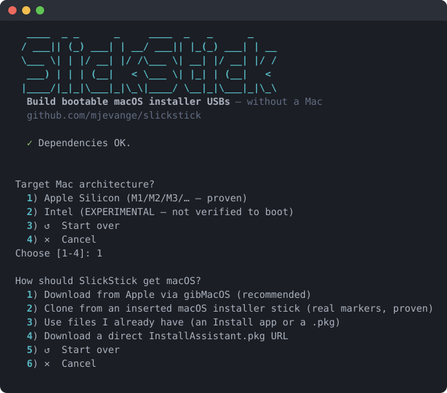

<p align="center">
  
</p>

# SlickStick

**Build bootable macOS installer USBs — without a Mac.**

SlickStick partitions a USB stick, formats it, and lays a macOS installer onto it
so an Apple Silicon Mac boots it straight from the startup picker — all from
Linux, with no Mac involved in the build. The macOS files are downloaded from
Apple at run time (or supplied from files you already have); **no Apple software
ships in this repo.**

It works because of one finding: an Apple Silicon installer volume has **no HFS+
"bless," an empty EFI partition, and a plain partition type** — the firmware
recognizes the installer by its *content*, not by boot metadata. So a faithful
content copy over Linux's own `hfsplus` driver is enough. See
[docs/how-it-works.md](docs/how-it-works.md).

<p align="center">
  
</p>

---

## Status — read this

| Path | State |
|------|-------|
| **Apple Silicon**, cloned from an installer stick (`--stick`) | ✅ **Proven** — boots to the installer |
| **Apple Silicon**, from a pkg (synthesized markers) | ✅ **Proven** — lists (with icon) + boots on hardware |
| **Intel** (recovery) | ✅ **Proven** — `build --recovery` builds an Apple Recovery stick on Linux (pkg-free, one stick) that **boots a real Intel Mac into Recovery**. See [docs/intel.md](docs/intel.md) |
| **Intel** (full installer) | ✅ **Proven** — clone a `createinstallmedia` stick (`build_intel_clone`) → boots a real Intel Mac into the **full installer** (branded icon; bless not required). Modern pkg→Intel is blocked (sealed asset) |

This is a tool for making install media for **Macs you own**. It erases the
target USB.

## Features

- **No Mac required** — partitions, formats, and lays down a bootable installer
  entirely from Linux.
- **Guided wizard *and* scriptable CLI** — menu-driven by default; every choice
  is also a flag for non-interactive use.
- **Four macOS sources** — download via **gibMacOS** (pick the exact version from
  Apple's live catalog, in SlickStick's own menu), **clone** an inserted
  installer stick, a **local** `.pkg`/Install app, or a direct Apple CDN **URL**.
- **Architecture-aware** — asks Apple Silicon vs Intel up front, filters the
  version list to match, and warns if a local installer can't boot the chosen arch.
- **Two build strategies** — **stream** writes straight to the USB with near-zero
  scratch space; **copy** keeps the unpacked app for instant re-flashes.
- **Correct boot markers** — synthesizes the exact `.IAPhysicalMedia` fields the
  Apple Silicon picker requires (boot-verified on hardware), or copies the real
  markers when cloning a stick.
- **Volume naming** — defaults to the chosen installer's name, fully customizable;
  it's what the Mac's startup picker shows.
- **Safety rails** — refuses internal disks, mounted system partitions, and the
  source disk; requires a typed device-name confirmation before wiping.
- **Nice touches** — Tab path-completion in the wizard, a per-distro dependency
  checker, a one-line install that works in any shell (bash/zsh/fish), and
  progress bars on every long operation.
- **Few dependencies** — a pure-Python pbzx decoder and HFS+ via Linux's own
  driver; no proprietary blobs, and no Apple software in the repo.

## Quick start

**Run it once — nothing installed.** Fetches to a temp dir, runs the wizard,
cleans up after itself:

```bash
curl -fsSL https://raw.githubusercontent.com/mjevange/slickstick/main/run.sh | bash
```

**Or install a reusable `slickstick` command** (clones to
`~/.local/share/slickstick`, launcher in `~/.local/bin`):

```bash
curl -fsSL https://raw.githubusercontent.com/mjevange/slickstick/main/install.sh | bash
```

Works in **any shell** — bash, zsh, **fish**. The bootstraps read your terminal
directly (`/dev/tty`), so the wizard stays interactive even through the pipe. To
pass arguments, append `-s --`, e.g. `… | bash -s -- devices`.

<details>
<summary>Prefer process substitution? (bash/zsh or fish)</summary>

```bash
bash <(curl -fsSL https://raw.githubusercontent.com/mjevange/slickstick/main/run.sh)       # bash / zsh
bash (curl -fsSL https://raw.githubusercontent.com/mjevange/slickstick/main/run.sh | psub) # fish
```
</details>

## Requirements

- Linux with the **`hfsplus` kernel module** (built in or loadable)
- `gptfdisk` (`sgdisk`), `hfsprogs` (`mkfs.hfsplus`/`fsck.hfsplus`), `libarchive`
  (`bsdtar`), `dosfstools`, `util-linux`, `curl`, `git`, Python 3.10+
- A USB stick **≥ 16 GB**
- Free disk for the work dir depends on the **strategy**: **stream** needs almost
  none for a local `.pkg` (and ~17 GB just to *download* for gibMacOS/URL);
  **copy** needs ~18 GB (local) to ~36 GB (download + extract). The stick-clone
  source streams straight to the target. SlickStick checks this before wiping.

Check everything at once:

```bash
slickstick deps
```

It prints the exact install command for your distro (Arch / Debian / Fedora) if
anything is missing.

## Usage

Just run it — the guided **wizard** walks you through everything:

```bash
slickstick
```

It checks your dependencies, asks the **target architecture**, **where to get
macOS** (and, for the gibMacOS source, which version — from Apple's live
catalog), whether you'll make more than one USB (keep the files or not), and a
**volume name** — then **detects your inserted USB, lists it, has you pick it,
and makes you type the device name to confirm** before erasing anything. Run it
as your **normal user** — it uses `sudo` only for the privileged partition/format
steps and prompts for your password then. No flags to memorize.

> Running from a git clone instead of the installer? Use `python3 slickstick.py`
> everywhere you see `slickstick` below.

<details>
<summary><b>Advanced / scripting</b> (flag-driven, non-interactive)</summary>

```bash
slickstick devices          # list USB disks
slickstick deps             # check required tools

# build to a specific disk without prompts
slickstick build --device /dev/sdb -y

# choose the macOS source explicitly
slickstick build -d /dev/sdb --local "/path/to/Install macOS ….app"
slickstick build -d /dev/sdb --url "https://.../InstallAssistant.pkg"

# clone an inserted installer stick (real markers — the proven path)
slickstick build -d /dev/sdb --stick /dev/sdc2

# stream straight to the USB from a pkg — ~0 scratch space, no 18 GB work dir
slickstick build -d /dev/sdb --local /path/InstallAssistant.pkg --strategy stream

# name the USB (shown in the Mac's startup picker; cosmetic)
slickstick build -d /dev/sdb --local /path/InstallAssistant.pkg --label "My Recovery Stick"
```

**Strategies** (pkg sources): `--strategy copy` (default) extracts to the work dir
then copies onto the USB — keeps the ~18 GB app so extra USBs are an instant
re-copy. `--strategy stream` writes straight onto the USB from the pkg — **~0
scratch space**, keeps nothing (ideal when disk is tight or the pkg is on a
network share).
</details>

## macOS sources

| Source | Flag | What it does |
|--------|------|--------------|
| **gibMacOS** (default) | — | Downloads a full installer from Apple via [corpnewt/gibMacOS](https://github.com/corpnewt/gibMacOS); pick the version in its menu |
| **stick** | `--stick /dev/sdX2` | **Clone an inserted installer stick** — the wizard detects and lists them. Copies the app *and the real root markers*, so it's the boot-verified path |
| **local** | `--local PATH` | Use an existing Install app or a downloaded `.pkg` |
| **url** | `--url URL` | Download a direct `InstallAssistant.pkg` URL from Apple's CDN |

New backends slot into `lib/sources/` behind a small interface.

### Root markers — three tiers

A `createinstallmedia` stick carries small root files (`.IAPhysicalMedia`,
`restore/`, `.VolumeIcon.icns`) that the pkg doesn't:

- **stick source** → copies the **real** markers verbatim.
- **any other source** → **synthesizes** `.IAPhysicalMedia` (`AppName`,
  `ProductBuildVersion` decoded from the pkg, `ProductVersion`) + a volume icon.
  Boot-verified on hardware — these are the exact fields the picker requires (see
  [docs/recognition-rules.md](docs/recognition-rules.md)).
- **`--reference-stick /dev/sdX`** → copy real markers onto an app that came
  from a non-stick source. Rarely needed now.

## How it works

The short version: GPT (Apple-HFS+-typed partition) → HFS+ → content-faithful
copy of the installer → a synthesized `.IAPhysicalMedia` marker → `fsck`. No
bless, no signing, no SharedSupport dive.

- **[docs/recognition-rules.md](docs/recognition-rules.md)** — the empirically
  reverse-engineered rule for *exactly* what Apple Silicon requires to list and
  boot a USB installer (with the full test matrix). The genuinely novel finding.
- **[docs/how-it-works.md](docs/how-it-works.md)** — the build method, the
  pbzx/dmg extraction, the "zero bless" discovery, and why Intel is harder.

## The story — why this "couldn't" be done, and how we proved it could

### Why it looked impossible

Every sign said *you need a Mac*:

- `createinstallmedia`, the only official way to build the media, **runs only on
  macOS**.
- Apple Silicon has a **signed, sealed boot chain** specifically designed to
  reject boot media assembled from parts.
- Conventional wisdom treated the HFS+ **"bless"** as a required, Mac-only step —
  and Linux can't even reliably *write* journaled HFS+.
- The installer's boot objects are **Apple-signed**; you can't forge them.

### The hypothesis

The crack in the wall: **booting and building are different problems.** A plain
`dd` clone of a working stick boots fine from Linux — which means the bytes
aren't secret. `createinstallmedia` contributes *procedure*, not magic material.
So if cloning works, maybe the "hard part" is just **arranging Apple's own
already-signed files**, not forging anything.

We chased some dead ends to get there — an "empty blessed skeleton" you could
reuse (impossible: a bless points *at* content, so there's nothing to pre-bake),
and swapping files into a blessed shell (exactly what the sealed chain blocks).
The move that worked: stop treating a known-good stick as a *donor* and use it as
an **oracle** — build a candidate, then *diff* against the real thing.

### What we tested

Reading a real installer stick overturned the core assumption:

- Its HFS+ **`finderInfo` was all zero** — *no bless at all.* (That one `dd` read
  also retired the bless-patching code we'd written, unused.)
- Its **EFI partition was empty**, and the HFS+ partition was a **plain Apple
  type** with no special flags.

No boot markers anywhere → **Apple Silicon recognizes the installer by its
content, not by metadata.** So we built a candidate entirely on Linux — GPT +
**non-journaled** HFS+ (chosen for clean writes, to isolate the one variable) +
a faithful content copy — then diffed it against the real stick: **identical file
tree (895/895 files, 20 symlinks, 0 hard links), `fsck`-clean.**

### The proof

The Linux-built stick, plugged into an M1, **appeared in the startup picker and
booted into the macOS installer's Recovery Assistant** — the same behavior as a
`createinstallmedia` stick. Theory proven: a bootable Apple Silicon installer,
built with no Mac in the loop.

*Scope:* both the stick-clone and pkg (synthesized-marker) paths are proven to
**list + boot** on real hardware. Intel is open — see the [Status](#status--read-this) table.

## Safety

- Refuses targets that are internal disks or carry a mounted `/`, `/boot`, `/home`.
- Won't use the same disk your source files came from.
- Requires a typed confirmation of the device name before wiping.

Always double-check the device — `/dev/sdX` names can shift between plug-ins.

## Legal

SlickStick ships **no Apple software**. It downloads macOS installers from
Apple's own servers at run time, the same way Apple's `softwareupdate` does, and
is intended for creating install media for Macs you own. macOS is © Apple.

## Credits

**Depends on**

- [corpnewt/gibMacOS](https://github.com/corpnewt/gibMacOS) — downloads macOS installers from Apple (MIT)
- [acidanthera/OpenCorePkg](https://github.com/acidanthera/OpenCorePkg) — `macrecovery.py`, used for the Intel recovery download (BSD-3)

**Prior art & inspiration** (ideas followed, not code bundled)

- The [Asahi Linux](https://asahilinux.org) project — the best public reference on Apple Silicon boot internals
- The one-line installer convention of [Homebrew](https://brew.sh), [rustup](https://rustup.rs), and [Oh My Zsh](https://ohmyz.sh) — the `bash <(curl …)` / `bash -c "$(curl …)"` bootstrap
- The `/dev/tty` idiom for keeping prompts interactive even under `curl | bash`

## License

[MIT](LICENSE)
